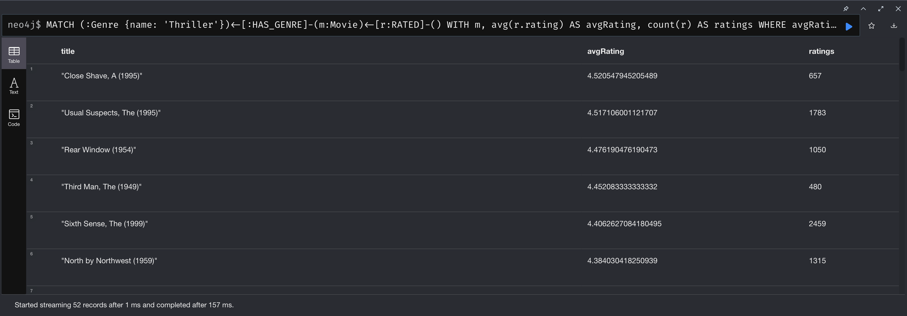
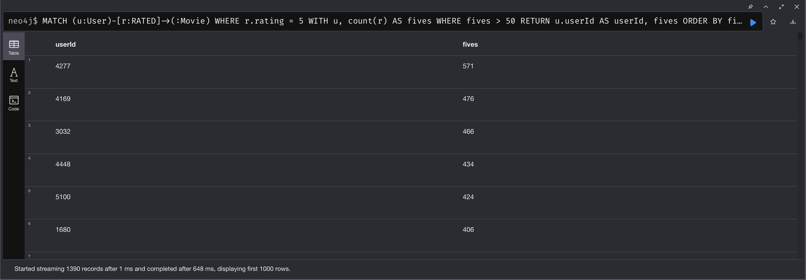
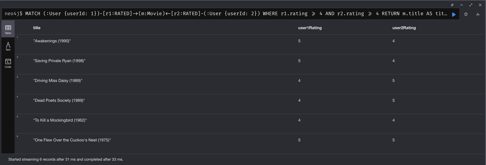
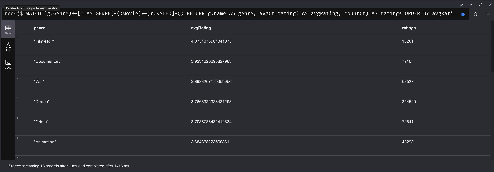
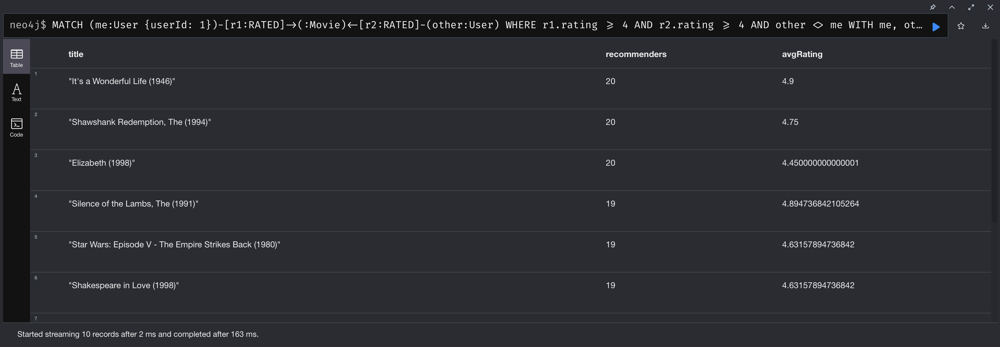
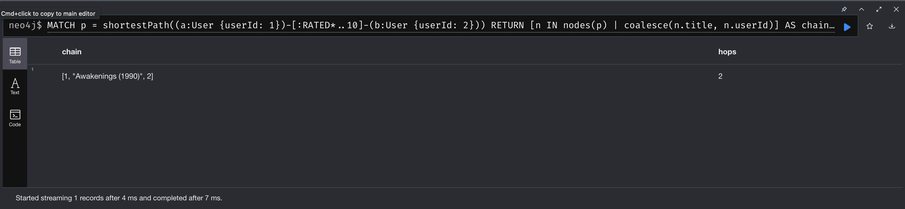

# Svietlov_nosql_3: MovieLens 1M у Neo4j

## Частина 1. Схема графа

```
            RATED {rating, timestamp}              HAS_GENRE
 (:User) ---------------------------> (:Movie) ---------------> (:Genre)
 {userId, gender, age, occupation}    {movieId, title, year}    {name}
```

**1.1. Що вузли, що ребра?** Користувач, фільм і жанр: самостійні сутності з власною
ідентичністю, на які посилаються багато інших записів, тому це вузли. «Користувач оцінив
фільм» і «фільм належить жанру» описують зв'язок між сутностями, тому це ребра. Оцінка
(rating, timestamp) є властивістю такого зв'язку.

**1.2. Оцінка: ребро чи вузол `Rating`?** Обрано ребро `RATED`. Ребро дає один хоп
User -> Movie, на мільйон оцінок не створюється мільйон додаткових вузлів, а обхід для
рекомендацій простіший. Вузол `Rating` потрібен, якщо до оцінки прив'язують інші сутності
(теги, сесії, коментарі), якщо можливо кілька оцінок однієї пари або якщо оцінки треба
індексувати як вузли. У MovieLens одна оцінка на пару, і до неї нічого не прив'язується,
а вузол коштував би 1 млн вузлів і вдвічі більше хопів. Тому ребро виграє.

**1.3. Чому `Genre` вузли, а не список у `Movie`?** Жанр це спільна сутність. Вузол дає
прямий обхід `(:Genre)<-[:HAS_GENRE]-(:Movie)` по ребрах замість перебору всіх фільмів і
розбору списку рядків. Рядок жанру зберігається один раз, а не в кожному фільмі, а агрегації
й пошук шляхів через жанри (запит 3.4) стають звичайними обходами графа.

## Частина 2. Завантаження даних

Нижче пояснення кожного запиту з `part2_load.cypher` за порядком.

1. Три `CREATE CONSTRAINT ... IF NOT EXISTS` (User.userId, Movie.movieId, Genre.name)
   задають унікальність ключів. Constraint створює індекс, тож `MERGE` і `MATCH` по ключу не
   скануватимуть усі вузли. Індекси створені до завантаження ребер, як вимагалося, а
   `IF NOT EXISTS` робить повторний запуск безпечним.
2. Користувачі: `LOAD CSV WITH HEADERS` читає `users.csv`, `MERGE` по `userId` не дублює
   вузли при повторному запуску, `toInteger` перетворює рядки CSV на числа, `SET` пише
   решту властивостей.
3. Фільми та жанри: `MERGE` фільму по `movieId`, `year` береться з кінця назви
   (`substring(title, size(title) - 5, 4)`, назви закінчуються на `(YYYY)`).
   `UNWIND split(row.genres, '|')` розкладає жанри рядка на окремі значення, `MERGE (g:Genre)`
   створює кожен жанр один раз, `MERGE (m)-[:HAS_GENRE]->(g)` створює ребро без дублів.
4. Оцінки: мільйон ребер в одній транзакції впаде через пам'ять/таймаут, тому
   `apoc.periodic.iterate` читає CSV зовнішнім запитом і виконує внутрішній пакетами по
   10000 (`batchSize`). Внутрішній запит знаходить `User` і `Movie` через `MATCH` по
   індексованих ключах і створює `RATED` через `MERGE` (ідемпотентність) з `rating`,
   `timestamp`. `parallel: false`, бо в тілі є `MERGE`, а паралельні потоки, що
   блокують одні й ті самі вузли, можуть дати deadlock або дублі.
5. Три перевірочні запити рахують `User`, `Movie` і `RATED`.

## Частина 3. Запити

Запити в `queries/part3.cypher`.

### 3.1. Thriller із середнім рейтингом вище 4.0



Знаходить фільми жанру Thriller через `HAS_GENRE`, збирає всі їхні оцінки,
`avg(r.rating)` і `count(r)` рахуються по фільму, `WITH ... WHERE` відфільтровує
агреговане значення (у `WHERE` після `MATCH` агрегат використати не можна). Додано
кількість оцінок, щоб бачити надійність середнього.

### 3.2. Користувачі з більш ніж 50 оцінками 5



`MATCH` + `WHERE r.rating = 5` беруть лише ребра з оцінкою 5, `count(r)` рахує їх на
користувача, `WITH ... WHERE fives > 50` фільтрує за агрегатом,
сортування за спаданням показує найактивніших.

### 3.3. Фільми, які користувачі 1 і 2 оцінили на 4 і вище



Один шаблон `(:User {userId: 1})-[r1]->(m)<-[r2]-(:User {userId: 2})` знаходить спільні
фільми прямим обходом від двох стартових вузлів по індексу, `WHERE` вимагає рейтинг >= 4 з
обох боків.

### 3.4. Жанри: середній рейтинг і кількість оцінок



Шлях `Genre <- Movie <- RATED` дає всі оцінки всіх фільмів жанру. Фільм з кількома жанрами
враховується в кожному з них, це очікувано. `avg` показує «стабільність» високих оцінок, а
`count` показує, що середнє не випадкове.

### 3.5. Рекомендації для користувача 1



Крок 1: знаходимо користувачів, які разом із користувачем 1 високо (>= 4) оцінили ті самі
фільми, рахуємо кількість спільних фільмів (`shared`) як міру схожості та беремо 20
найсхожіших (`LIMIT` перед другим `MATCH` обмежує обсяг обходу). Крок 2: беремо їхні фільми
з оцінкою >= 4, які користувач 1 ще не оцінював (`NOT EXISTS { (me)-[:RATED]->(rec) }`).
Фільми ранжуються за числом схожих користувачів, що їх рекомендують, і середньою оцінкою.

### 3.6. Найкоротший ланцюжок між користувачами 1 і 2



`shortestPath` шукає найкоротший шлях по `RATED` між двома користувачами. Напрям не
вказано (`-[:RATED*..10]-`), бо ребра йдуть лише User -> Movie, а шлях проходить їх і
вперед, і назад. Обмеження `..10` захищає від розгляду надто довгих шляхів.
`nodes(p)` перетворюється на список назв фільмів і id користувачів.

### Довжина шляху

Довжина шляху це кількість ребер `RATED`. Користувачі й фільми чергуються, тому шлях між
двома користувачами завжди парний.

- Довжина 2: два користувачі оцінили один і той самий фільм (як 1 і 2 через «Awakenings»).
- Довжина 4: між ними є проміжний користувач, `u1 - m1 - u - m2 - u2`. Вони не мають
  спільного фільму, але пов'язані через третього користувача, який перетинається з обома.
- Довжина 6: два проміжні користувачі, ланцюжок з трьох перетинів смаків. Зв'язок слабший,
  чим довший шлях, тим менш схожі смаки.

## Частина 4. Супервузли

Запити в `queries/part4_supernodes.cypher`.

1. Топ-20 вузлів за ступенем: `MATCH (n)` проходить усі вузли, `COUNT { (n)--() }` рахує
   всі ребра вузла в будь-якому напрямі, `labels(n)[0]` і `coalesce(title, name, userId)`
   дають зрозумілу назву вузла будь-якого типу, `ORDER BY ... LIMIT 20` залишає найбільші.
2. Середній і максимальний ступінь за типом вузла: показує норму для порівняння, щоб
   зрозуміти, що саме є аномальним.
3. Ступінь вузлів `Genre` (кількість фільмів жанру через `HAS_GENRE`): потрібна для
   питання 4.3.

**4.1. Які вузли стали супервузлами?** Найбільший ступінь мають популярні фільми:
«American Beauty (1999)» (3430 ребер: 3428 оцінок і 2 жанри), «Star Wars: Episode V»
і «Star Wars: Episode IV» (по 2995), «Star Wars: Episode VI» (2888), «Jurassic Park» (2675).
Серед користувачів найбільший ступінь має користувач 4169 (2314 оцінок) при середньому 165.6.
Також вузли `Genre`: «Drama» пов'язана з 1603 фільмами (а через них з 354529 оцінками),
«Comedy» з 1200 фільмами (356580 оцінок). Середній ступінь фільму 259.

**4.2. Чому запит через такий вузол повільніший?** Індекс знаходить лише стартовий вузол.
Далі Neo4j має обійти всі його ребра і для кожного перевірити тип, напрям і властивості
(наприклад, `rating >= 4`) та перейти до сусіднього вузла. Вартість обходу пропорційна
ступеню, а не індексу: 3430 ребер замість ~260 у типового фільму, а для жанру `Drama`
це сотні тисяч ребер при обході `Genre -> Movie -> RATED`. Це більше db hits, пам'яті та
проміжних рядків, а запити, що розгортаються через такий вузол далі, множать
вартість на кожному кроці.

**4.3. Яка стратегія?** Жанрові вузли теж супервузли, фактично найбільші. Рекомендації:
уникати обходу через `Genre` без фільтра: спершу звужувати набір (за користувачем, роком,
рейтингом), потім переходити до жанру; зберігати попередньо обчислені агрегати (`avgRating`,
`ratingCount`) на `Movie` і `Genre`, щоб не обходити мільйони ребер щоразу; винести жанр
у додатковий лейбл вузла `Movie` (наприклад, `:Movie:Thriller`), тоді фільми жанру
вибираються за лейблом без розгортання супервузла `Genre`; розділити ребра супервузла на
спеціалізовані типи, наприклад, `RATED_5` або `RATED_HIGH` для оцінок >= 4, тоді запити
по високих оцінках не проходять ребра з низькими.

## Частина 6. Аналіз і висновки

**6.1. Граф vs SQL.** Запити 3.1, 3.2 і 3.4 у SQL прості (`JOIN` + `GROUP BY` + `HAVING`).
Складно в SQL запити 3.5 і 3.6. Запит 3.5 потребує самоз'єднань `ratings` з самою собою
(фільми, спільні для двох користувачів), потім ще одного з'єднання для кандидатів і
анти-з'єднання `NOT EXISTS`. Кожне з'єднання ratings (1 млн рядків) з собою дорого
без обхідних індексів. Запит 3.6 найкоротшого ланцюжка невідомої довжини вимагає
рекурсивного CTE з кроком user -> movie -> user, а кількість самоз'єднань залежить від
довжини шляху, що заздалегідь невідома, а рекурсія розростається експоненційно й
потребує захисту від циклів. У Cypher це один `shortestPath`. Еквівалент 3.6 у SQL (таблиця
`ratings(user_id, movie_id, rating, ts)`):

```sql
WITH RECURSIVE chain(user_id, depth, path) AS (
  SELECT 1, 0, ARRAY[1]
  UNION ALL
  SELECT r2.user_id, c.depth + 1, c.path || r2.user_id
  FROM chain c
  JOIN ratings r1 ON r1.user_id = c.user_id
  JOIN ratings r2 ON r2.movie_id = r1.movie_id AND r2.user_id <> c.user_id
  WHERE c.depth < 5 AND NOT r2.user_id = ANY(c.path)
)
SELECT depth, path FROM chain WHERE user_id = 2 ORDER BY depth LIMIT 1;
```

Цей запит перебирає всі шляхи (кожен рівень множить кількість рядків), тоді як
`shortestPath` у графі зупиняється на першому знайденому і не матеріалізує всіх шляхів.

**6.2. Де граф програє?** Для задач, де треба обробити всі дані, а не пройти від кількох
стартових вузлів. Агрегація по всіх користувачах (середня оцінка за віковими групами,
розподіл оцінок, кількість оцінок за місяць), звіти й експорт даних у таблиці це
послідовне сканування й групування, у чому реляційні та колонкові СУБД швидші та мають
простіший синтаксис. Графова модель не має переваги, коли зв'язки не обходяться:
оцінка в таблиці `ratings` з індексами та `GROUP BY` дає такий самий результат без
накладних витрат на ребра. Ще один недолік це супервузли: популярні фільми та жанри
уповільнюють обходи, тоді як у SQL такі агрегації виконує звичайний план з хеш-групуванням.

**6.3. Покращення схеми.** Для запитів 3.1 і 3.4 варто зберігати на `Movie` попередньо
обчислені `avgRating` та `ratingCount` (а на `Genre` сумарні значення): тоді 3.1 стає
фільтром по властивості вузла `Movie` без обходу оцінок, а 3.4 читає 18 вузлів `Genre`
замість обходу 1 млн ребер. Ціна: значення треба оновлювати при додаванні оцінки. Для
запитів 3.2, 3.3 і 3.5 прискорить розділення ребер за типом: `RATED_HIGH` (оцінка >= 4) або
`RATED_5`. Тоді 3.2 рахує ребра `RATED_5` без перевірки властивості, а 3.3 і 3.5 проходять
лише «позитивні» ребра і не перебирають усі оцінки супервузлів. Альтернатива це індекс по
властивості ребра `RATED.rating`, який дозволяє `WHERE r.rating = 5` не скануючи всі ребра.
